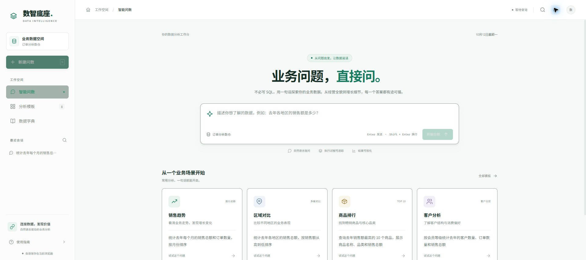
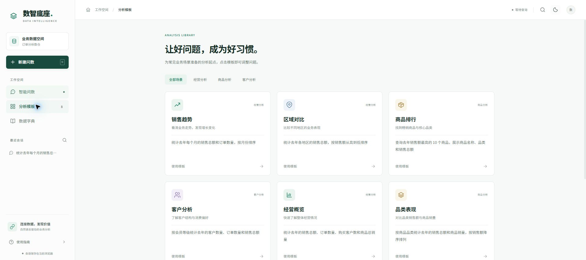
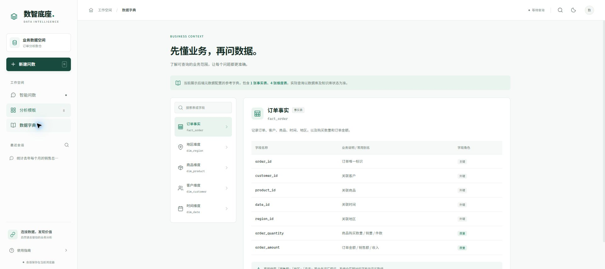

# 数智底座 · 数据分析工作台

基于 Vue 3 的智能问数前端。业务用户可以使用自然语言查询订单数据仓库，查看真实执行进度，并通过表格、图表和 CSV 导出继续分析。

后端项目：[data-agent](https://github.com/luckyblank/data-agent)。

## 项目截图

以下截图来自项目实际运行界面，图片随仓库保存在 `docs/images/`。

### 智能问数首页

以自然语言输入为中心，提供销售趋势、区域对比、商品排行和客户分析等常用场景。



### 分析模板

内置 8 个基于订单数仓配置的业务分析模板，支持按经营分析、商品分析和客户分析筛选，点击模板可填入并调整问题。



### 数据字典

展示订单事实表与地区、商品、客户、时间维度的字段、业务别名和角色，帮助用户了解可查询的数据范围。



## 功能

- 问数交互：自然语言输入、Enter 发送、Shift + Enter 换行，兼容中文输入法；可关闭正在接收的数据流。
- 执行追踪：按后端 SSE 事件展示真实节点进度，包括并行召回、SQL 生成、预校验、纠错和执行。完成后默认收起执行过程。
- 结果分析：动态字段、搜索、排序、分页、柱状图与折线图、维度和数值选择、CSV 导出。
- 会话管理：新建、恢复、收藏、删除及关键词搜索；`Ctrl/Cmd + K` 打开历史会话。
- 场景模板：经营概览、销售趋势、区域对比、省份销售、商品排行、品类表现、品牌分析、客户分析。
- 桌面工作台：浅色和深色主题、侧栏导航、空结果和错误提示。

## 本地开发

需要 Node.js 22.12+ 或 24，以及 npm。

```powershell
npm ci
npm run dev
```

默认访问 `http://localhost:5173/`。开发服务器监听局域网，其他设备可使用本机 IP 加端口访问。端口被占用时，以 Vite 输出的实际地址为准。

前端请求 `POST /api/query`，Vite 默认将 `/api` 代理到 `http://localhost:8000`。调整后端地址时，将 `.env.example` 复制为 `.env.local`，修改 `VITE_API_PROXY_TARGET` 并重启开发服务器。

```powershell
Copy-Item .env.example .env.local
```

## 构建与验证

```powershell
npm test
npm run build
npm run preview
```

生产文件输出到 `dist/`。生产部署需要由 Web 服务器把 `/api` 代理到 FastAPI，开发代理配置不会写入生产包。

测试覆盖 SSE 跨块中文解码、CRLF 和多行事件、尾部未分隔事件、HTTP 错误、异常 JSON、动态字段、数值识别与 CSV 转义。开发时可打开 `/tests/result-preview.html` 查看明确标注的固定测试数据，检查结果组件；该页面不进入生产构建。

## 数据与接口说明

场景模板和参考字典来自后端 `conf/meta_config.yaml`。字典为前端配置参考，实际查询以数据库和知识库状态为准；模板、首页及图表不会伪造业务查询结果。

当前仅对接订单分析数仓，侧栏和输入区的数据源名称为只读标识。查看表和字段说明时，使用侧栏「数据字典」或首页「查看数据字典」入口。

每次问数独立发送完整问题，当前后端不接收历史聊天上下文，也不返回 SQL 文本。关闭前端数据流不代表后端任务一定已终止。

会话、收藏和主题保存在当前浏览器。最多保留 30 个会话，每个会话持久化最近 20 次查询、每次查询前 500 行结果；当前查询页面可以查看和导出接口返回的完整结果。历史数据被截取时会显示提示，可重新查询获取完整结果。

## 代码结构

- `src/App.vue`：工作空间导航、问数首页、模板、字典与弹窗。
- `src/components/QueryComposer.vue`：问题输入与发送。
- `src/components/QueryResponse.vue`：查询状态与执行过程。
- `src/components/ResultPanel.vue`：表格、图表与结果导出。
- `src/composables/useWorkspace.js`：请求管理、会话状态与本地保存。
- `src/utils/queryStream.js`：SSE 流解析。
- `src/utils/result.js`：动态字段、数值与 CSV 工具。
- `src/data/workspace.js`：业务模板、字段字典与节点说明。
- `src/style.css`：青绿色企业工作台设计与响应式布局。
- `docs/images/`：README 中的真实页面截图。
